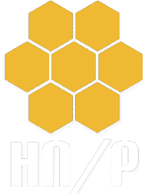

## Workshop on Active Defense and Deception
The 6th Workshop on Active Defense and Deception (AD&D) will take place on July 9, 2027, in Madrid, Spain, co-located with the 12th IEEE European Symposium on Security and Privacy ([IEEE EuroS&P'27](https://eurosp2027.ieee-security.org/)). AD&D is supported by [The Honeynet Project](https://www.honeynet.org).

The AD&D workshop intends to promote **Active Defense** (AD) as an additional layer of protection against the imbalance of active attackers and passive defenders. In particular, the "assume breach" mentality is becoming the new normal, proactively interacting with adversaries using deception, system modification and run-time defensive mechanisms can offer a very viable method for detecting sophisticated multi-stage attacks. Although this methodology has great promise, AD is currently being underutilized because there are several barriers preventing wider industry acceptance such as: developing methods for measuring the value and effectiveness of AD, implementing AD in current systems, and understanding what motivates attacker behavior.

Therefore, the purpose of the AD&D workshop is to bring together multiple disciplines including Information Security, Cognitive Science and Psychology to help develop solutions to overcome some of the above mentioned barriers and increase adoption. More broadly, the Workshop wants to provide a forum to discuss issues associated with evaluating AD, influencing attacker decisions making and designing deceptions which have long-term viability with the ultimate goal of moving AD from theoretical concepts into practical applications.

## Important Dates
All deadlines are [Anywhere on Earth (AoE = UTC-12h)](https://www.timeanddate.com/time/zones/aoe).

* Submission deadline: February 27, 2027
* Notification of acceptance: March 27, 2027
* Camera ready: April 7, 2027
* Workshop date: July 9, 2027

## Call for Papers
The AD&D workshop invites submissions from researchers and practitioners in the field of Active Defense and Deception. The workshop aims to promote Active Defense as an effective extra security layer, advancing research and encouraging its adoption by industry.

### Topics of Interest
Topics of interest include, but are not limited to:

* All types of active defense methods: moving target defense, dynamic and runtime defenses, and deception use cases
* Attacker engagement in different stages of the attack lifecycle
* Measuring the overhead of active defense
* Experiment designs and frameworks to measure the effectiveness of active defense
* Feedback from real-world uses of active defense, canaries, and honeypots: what worked and what did not?
* Automation of active defense and deception
* Monitoring, alerting, containment, and deceptive response strategies
* Ensuring longevity and continuation of deception
* Attackers' reasoning, decision making, and behavior patterns
* Cognitive approaches that attackers can get prepared against
* Deceiving humans vs. deceiving computers: how can cognitive biases of attackers be influenced through computers?
* Deception for offense: social engineering, phishing, disinformation, dark patterns in UI/UX, and other manipulation techniques
* Adapting offensive deceptive techniques to defense
* Interdisciplinary research methods to improve active defense via attackers' human factors

Authors are encouraged to contribute research that addresses these topics and pushes the boundaries of knowledge in Active Defense and Deception. Papers reporting industry experiences and case studies will also be encouraged.

__Note that we exclude the concepts of preemptive attacks, hacking back, and counterattacks.__

## Submission Guidelines
We accept two different types of submissions:

- **Research Papers:** Traditional research papers with novel contributions are accepted in full paper format. The full papers must be no longer than 13 pages. References and appendices will not count towards this limit, but reviewers are not required to read the appendices.
- **Position and Experience Papers:** Position papers should present novel, preliminary research ideas or perspectives that aim to spark discussion and exploration within the community. Experience papers should share novel insights, findings, or lessons learned from real-world applications or deployments in the context of active defense. In both cases, submissions must not exceed 8 pages and should include the text "Position Paper:" or "Experience Paper:" at the beginning of the title. References and appendices do not count toward the page limit; however, reviewers are not obligated to read the appendices.

Submitted papers must be written in English and must not exceed 13 pages (or 8 pages for Experience and Position papers), excluding references and appendices. Papers must be typeset in LaTeX in A4 format (not US Letter) using the IEEE EuroS&P conference proceedings template ([eurosp2027-template.zip](https://eurosp2027.ieee-security.org/eurosp2027-template.zip)) while adhering to the guidelines of the main conference. Papers must be anonymized. For further information please refer to the "Page Limit and Formatting" section of the [IEEE EuroS&P'27 call for papers](https://eurosp2027.ieee-security.org/cfp.html).

The program committee will evaluate the submissions based on relevancy, impact, and the potential to spark discussion at the workshop. Interdisciplinary work is appreciated and encouraged.

**Submission URL**: TBD

### Review Process and Proceedings
All submissions will undergo a *double-blind* reviewing process, so authors must make sure that initial submissions do not contain information that might reveal their identity (e.g., author names, affiliations, email addresses, or obvious self-references). It is the author's responsibility to ensure that their anonymity is preserved when citing their own work. Failures to adhere to these requirements can be grounds for rejection.

Accepted papers will be published through IEEE Xplore in a volume accompanying the main IEEE EuroS&P 2027 proceedings. Authors may choose to have their paper excluded from the proceedings by selecting the "Exclude from conference proceedings" topic on the submission site. At least one author for each accepted paper is expected to register and participate in the workshop for presentation.

All submissions considered for inclusion in the proceedings must contain an original contribution and should not be concurrently submitted to other workshops, conferences, or journals. These requirements are relaxed for papers that will not be included in the proceedings.

### Proactive Prevention of Harm
We expect authors to carefully consider and address the potential harms associated with carrying out their research, as well as the potential negative consequences that could stem from publishing their work. Failure to adequately discuss such potential harms within the body of the submission may result in rejection of a submission, regardless of its quality and scientific value. These are particularly relevant to topics such as social engineering and the deception of humans, which are of interest to the AD&D workshop.

### Open Science Expectations
Our expectation for EuroS&P is that researchers will maximize the scientific and community value of their work by making it as open as possible. This means that, by default, all the code, data, and other materials (such as survey instruments) needed to reproduce the work described in an accepted paper will be released publicly under an open-source license.

Sometimes it is not possible to share work this openly, such as when it involves malware samples, data from human subjects that must be protected, or proprietary data obtained under agreement that precludes publishing the data itself. All submissions are encouraged to include a clear statement on Data Availability that explains how the artifacts needed to reproduce their work will be shared, or an explanation of why they will not be shared. If data reproducibility is required for significant contributions of the work and the authors do not explain reproducibility and/or share the artifacts, papers that fail to satisfy these commitments may be removed from the conference.

### Use of AI
The use of AI-generated content (including but not limited to text, figures, images, and code) shall be disclosed in the acknowledgments section. At the time of submission, the acknowledgments do not count towards the page limit. The AI system used shall be identified, and specific sections of the article that use AI-generated content shall be identified and accompanied by a brief explanation regarding the level at which the AI system was used to generate the content.

The use of AI systems for editing and grammar enhancement is common practice and, as such, is generally outside the intent of the above policy. In this case, disclosure as noted above is not required, but recommended.

Following the [IEEE Reviewer Policy](https://journals.ieeeauthorcenter.ieee.org/submit-your-article-for-peer-review/become-an-ieee-reviewer/#ai), reviewers must not use AI tools to generate or draft reviews.

## Organization

### General Chairs
* Denis Donadel, Fondazione Bruno Kessler, Italy
* Francesco Lupia, University of Calabria, Italy
* Domenico Siracusa, University of Trento, Italy

### Steering Committee
* Georgios Portokalidis, IMDEA Software
* Merve Sahin, SAP Security Research
* Nick Nikiforakis, Stony Brook University
* Emmanouil Vasilomanolakis, Technical University of Denmark

### Web Chairs
* Anastasia Safargalieva, Technical University of Denmark
* Dario Maddaloni, Technical University of Denmark

### Technical Program Committee 
TBD

## Supported by

  <a class="support-card support-card-link" href="https://www.honeynet.org" target="_blank" rel="noopener noreferrer">
    

      
    

    
The Honeynet Project

  </a>

 
 
